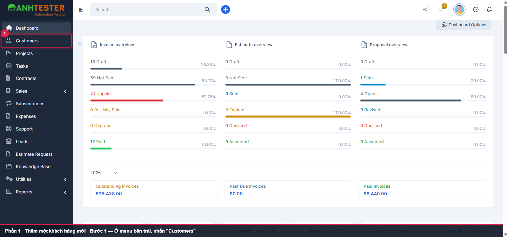
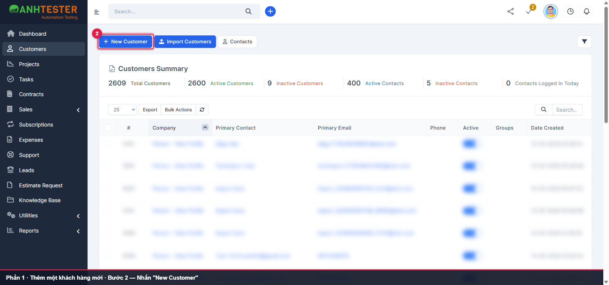
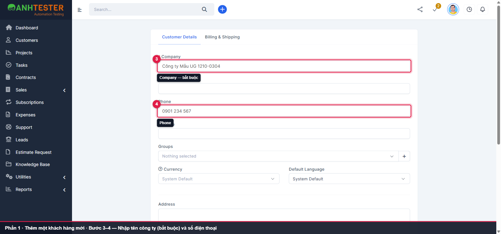
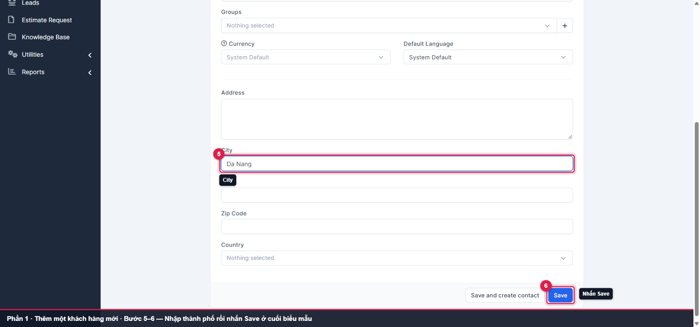
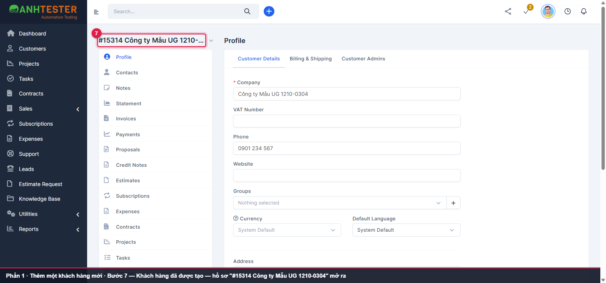
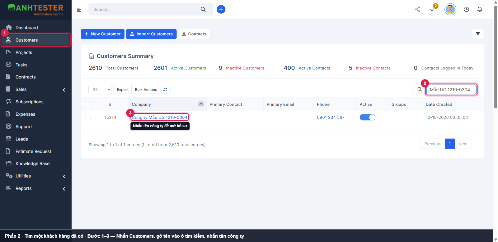

# Hướng dẫn sử dụng — Perfex CRM (Anh Tester Demo) · Khách hàng

| | |
|---|---|
| Phiên bản tài liệu | v1.0 |
| Áp dụng cho phiên bản phần mềm | Perfex CRM — Anh Tester Demo, trạng thái chạy thật ngày **12-10-2026** |
| Đối tượng đọc | **Nhân viên nội bộ** — vai trò `Admin` |
| Ngày cập nhật | 12-10-2026 |
| Cấu trúc tài liệu | Biên soạn theo cấu trúc ISO/IEC/IEEE 26514 |
| Trạng thái | 🟨 Bản **nội bộ** — bản gửi ra ngoài xuất HTML bằng `--release` (tự cắt mục 6) |

**Video trọn luồng (51 giây):**

<video src="video/full_walkthrough.mp4" title="Video — Thêm khách hàng mới và tìm lại khách hàng" controls width="100%"></video>

💡 Khung đỏ, số thứ tự và dải chú thích tối màu trong ảnh/video do tài liệu thêm vào để chỉ chỗ thao tác — không phải giao diện phần mềm. Vùng mờ là dữ liệu khách hàng khác, được làm mờ có chủ đích.

---

## 1. Trước khi bắt đầu

- **Bạn cần có:** tài khoản nhân viên có quyền quản lý khách hàng, **đã đăng nhập** — cách đăng nhập xem [Hướng dẫn Đăng nhập & Đăng xuất](../login/user_guide_login.md)
- Giao diện hiển thị **tiếng Anh**; tài liệu giữ nguyên nhãn trên màn hình (in đậm)

---

## 2. Bạn muốn làm gì?

| Tôi muốn… | Xem mục |
|---|---|
| Thêm một khách hàng mới | 3.1 |
| Tìm một khách hàng đã có và mở hồ sơ | 3.2 |

---

## 3. Các thao tác

### 3.1 Thêm một khách hàng mới

**Khi nào dùng:** khi có khách hàng mới cần đưa vào hệ thống.

<video src="video/p2_them_khach_hang.mp4" title="Video — Thêm một khách hàng mới (3.1)" controls width="100%"></video>

1. Ở menu bên trái, nhấn **Customers**.

   

2. Nhấn **New Customer** ở góc trên bên trái danh sách.

   

3. Biểu mẫu mở ở tab **Customer Details**. Nhập tên công ty vào ô **Company** — đây là ô **bắt buộc duy nhất** (có dấu `*`).
4. Nhập số điện thoại vào ô **Phone** (không bắt buộc).

   

5. Điền thêm các ô khác nếu có, ví dụ **City** (không bắt buộc).
6. Kéo xuống cuối biểu mẫu, nhấn **Save**.

   

Hệ thống hiện thông báo **"Customer added successfully."** và mở hồ sơ khách hàng vừa tạo, tiêu đề dạng **#<mã> <tên công ty>**.

💡 Sau khi nhập **Company**, hệ thống tự kiểm tra tên trùng. Nếu nhấn **Save** mà trang chưa chuyển, chờ một giây rồi nhấn lại.

**Nếu không được:**

| Bạn thấy | Nghĩa là | Làm gì |
|---|---|---|
| Dòng đỏ **`This field is required.`** dưới ô **Company** | Bạn chưa nhập tên công ty | Nhập tên công ty rồi nhấn **Save** lại |
| Khung xanh **`It looks that a customer with name … already exists, if you still want to create the customer you can ignore this message.`** | Đã có khách hàng trùng tên — đây chỉ là nhắc nhở | Kiểm tra lại ở mục 3.2; đúng là khách hàng mới thì cứ nhấn **Save** |

### 3.2 Tìm một khách hàng đã có và mở hồ sơ

**Khi nào dùng:** cần xem hoặc sửa thông tin một khách hàng.

<video src="video/p2_tim_khach_hang.mp4" title="Video — Tìm một khách hàng đã có (3.2)" controls width="100%"></video>

1. Ở menu bên trái, nhấn **Customers**.
2. Gõ tên công ty vào ô **Search...** phía trên bên phải bảng. Bảng tự lọc, chỉ còn các khách hàng khớp.
3. Nhấn tên công ty trong cột **Company**.

   

Hồ sơ khách hàng mở ra ở tab **Profile**.

---

## 4. Câu hỏi thường gặp

**Tạo hai khách hàng trùng tên được không?**
Được. Hệ thống chỉ hiện khung nhắc tên đã tồn tại, không chặn việc lưu.

---

## 5. Bảng đối chiếu nhãn màn hình

| Nhãn trên màn hình | Nghĩa |
|---|---|
| **Customers** · **New Customer** | Khách hàng · Thêm khách hàng mới |
| **Customer Details** · **Billing & Shipping** | Thông tin khách hàng · Địa chỉ thanh toán & giao hàng |
| **Company** · **Phone** · **City** | Tên công ty · Số điện thoại · Thành phố |
| **Save** · **Save and create contact** | Lưu · Lưu rồi thêm người liên hệ ngay |
| **Search...** | Ô tìm kiếm trong bảng |
| `Customer added successfully.` | Đã thêm khách hàng |

<!-- internal:start -->
---

## 6. Vùng chưa xác minh (nội bộ)

| Nội dung | Vì sao chưa xác minh |
|---|---|
| Thông báo `This field is required.` và khung trùng tên (3.1 — *Nếu không được*), câu trả lời mục 4 | Lấy từ requirements `CUST` (`REQ-CUST-40`, `44`, `45`); lần quay 12-10-2026 không tái hiện |
| Nút **Save and create contact** và tab **Billing & Shipping** | Có trên màn hình nhưng chưa hướng dẫn trong bản này |
| Dữ liệu tạo khi quay: khách hàng `#15313 Công ty Mẫu UG 1210-0301`, `#15314 Công ty Mẫu UG 1210-0304` | Môi trường dùng chung — cần dọn sau khi duyệt tài liệu |
| Ảnh có số liệu Dashboard / tổng số khách hàng của môi trường demo; bảng khách hàng khác đã làm mờ | Soát lại trước khi gửi ra ngoài |

## 7. Nhật ký tài liệu

| Ngày | Phiên bản | Thay đổi |
|---|---|---|
| 12-10-2026 | v1.0 | Bản đầu tiên bằng `/generate-user-guide` **Mode VIDEO**, `lang` vi — 2 thủ tục, 6 ảnh có highlight, 2 video phần + 1 video trọn luồng (51 s), HTML nhúng ảnh + video. Khâu phụ (đăng nhập) chạy ngoài video |
| 12-10-2026 | v1.0 | Ảnh mục 3.2 chụp lại thành `p2-2-s1-3-tim-khach-hang.png`: thêm khung số **1** ở menu **Customers** (bản cũ chỉ khoanh bước 2–3) |
<!-- internal:end -->
