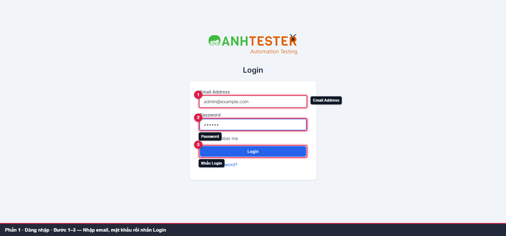
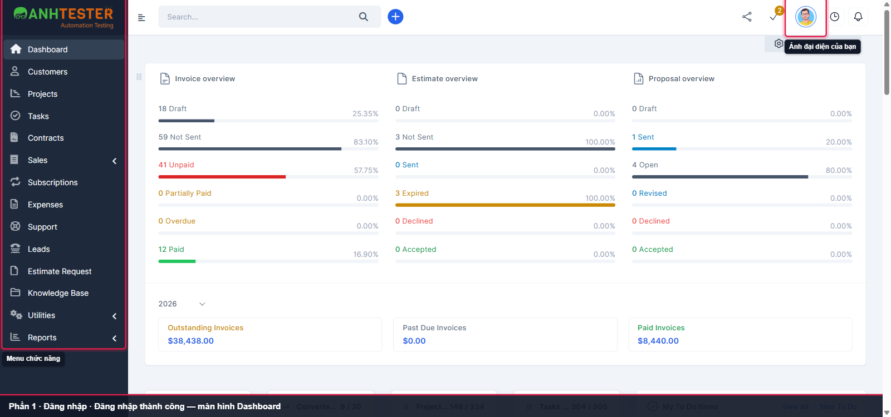
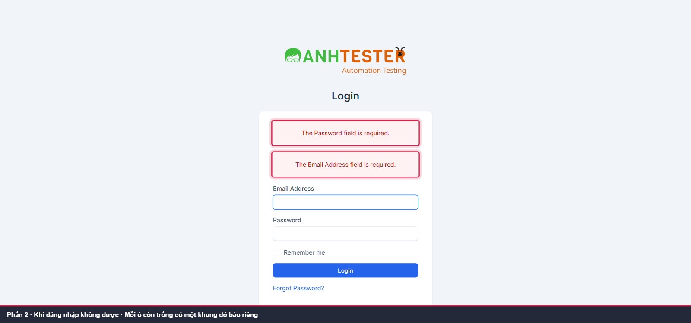
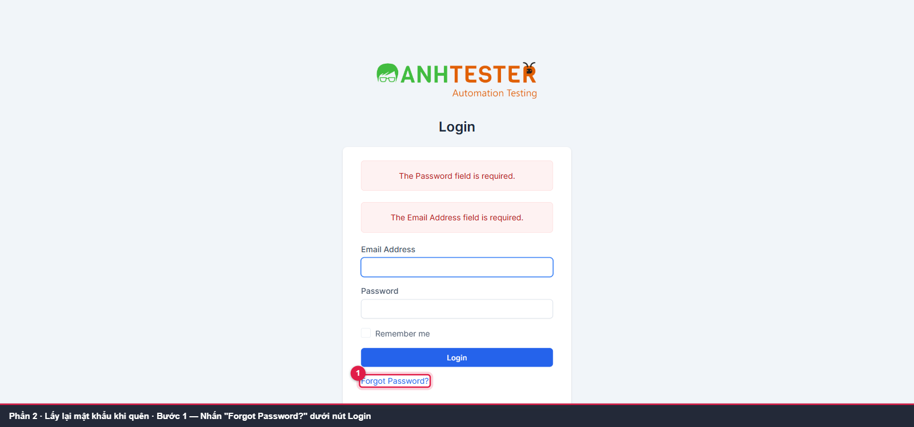
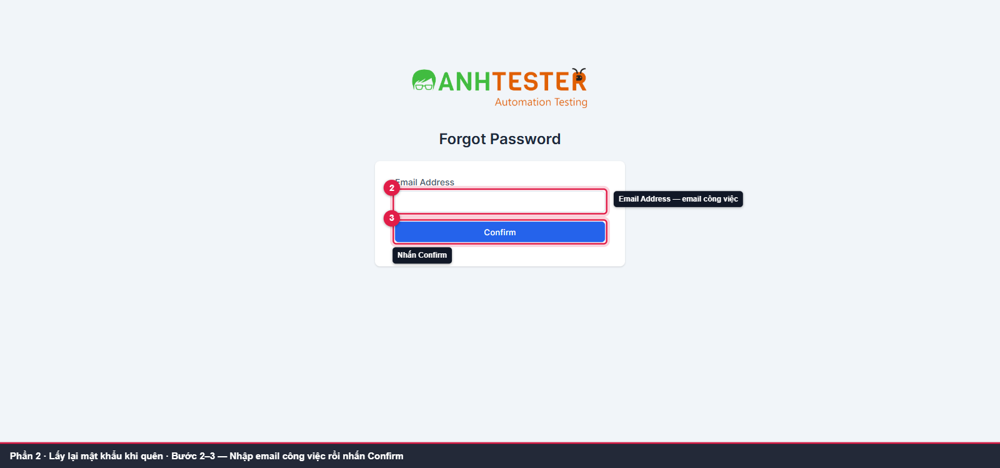
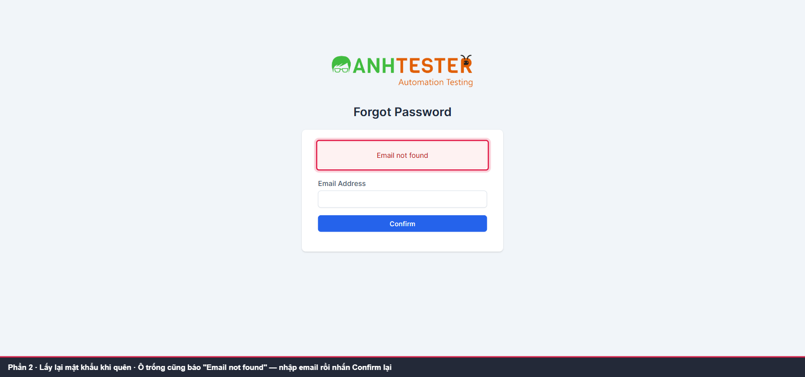
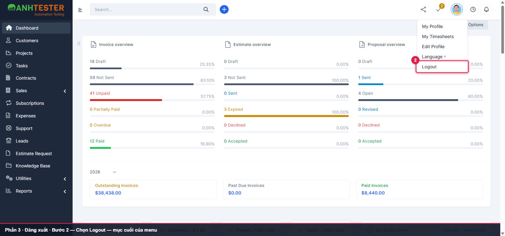
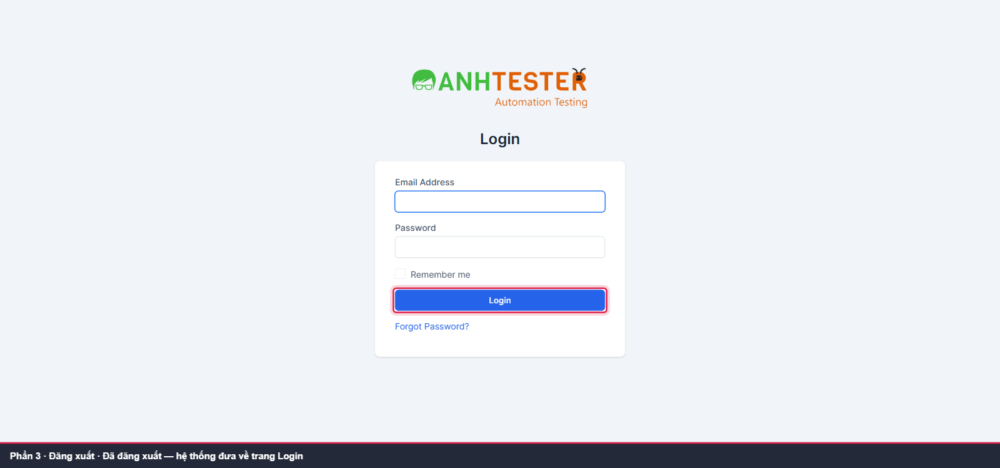

# Hướng dẫn sử dụng — Perfex CRM (Anh Tester Demo) · Đăng nhập & Đăng xuất

| | |
|---|---|
| Phiên bản tài liệu | v2.0 |
| Áp dụng cho phiên bản phần mềm | Perfex CRM — Anh Tester Demo, trạng thái chạy thật ngày **12-10-2026** |
| Đối tượng đọc | **Nhân viên nội bộ** — vai trò `Admin` và `Project Manager` |
| Ngày cập nhật | 12-10-2026 |
| Cấu trúc tài liệu | Biên soạn theo cấu trúc ISO/IEC/IEEE 26514 |
| Trạng thái | 🟨 Bản **nội bộ** — bản gửi ra ngoài xuất HTML bằng `--release` (tự cắt mục 6) |

**Video trọn luồng (50 giây):**

<video src="video/full_walkthrough.mp4" title="Video — Đăng nhập, khi đăng nhập không được, đăng xuất" controls width="100%"></video>

💡 Khung đỏ, số thứ tự và dải chú thích tối màu trong ảnh/video do tài liệu thêm vào để chỉ chỗ thao tác — không phải giao diện phần mềm.

---

## 1. Trước khi bắt đầu

- **Bạn cần có:** tài khoản nhân viên (vai trò `Admin` hoặc `Project Manager`) do quản trị hệ thống cấp
- **Trình duyệt:** Google Chrome trên máy tính
- **Địa chỉ đăng nhập:** `<địa chỉ hệ thống>/admin/authentication` — quản trị hệ thống cung cấp cho bạn
- Giao diện hiển thị **tiếng Anh**; tài liệu giữ nguyên nhãn trên màn hình (in đậm). Bảng đối chiếu ở [mục 5](#5-bang-oi-chieu-nhan-man-hinh)

❗ **THẬN TRỌNG:** Nếu bạn là **khách hàng** (không phải nhân viên), đây **không** phải cổng đăng nhập của bạn — xem [mục 4](#4-cau-hoi-thuong-gap).

---

## 2. Bạn muốn làm gì?

| Tôi muốn… | Xem mục |
|---|---|
| Đăng nhập vào hệ thống | 3.1 |
| Xử lý khi đăng nhập không được | 3.1 — *Nếu không được* |
| Lấy lại mật khẩu khi quên | 3.2 |
| Đăng xuất khỏi hệ thống | 3.3 |

---

## 3. Các thao tác

### 3.1 Đăng nhập vào hệ thống

**Khi nào dùng:** mỗi lần bắt đầu phiên làm việc, và mỗi khi hệ thống đưa bạn về trang đăng nhập.

<video src="video/p1_dang_nhap.mp4" title="Video — Đăng nhập (3.1)" controls width="100%"></video>

1. Mở trình duyệt, vào `<địa chỉ hệ thống>/admin/authentication`. Trang hiện tiêu đề **Login**.
2. Nhập email công việc vào ô **Email Address**.
3. Nhập mật khẩu vào ô **Password** — ký tự hiện dạng chấm tròn.
4. Nhấn **Login**.

   

Hệ thống mở màn hình **Dashboard**: menu chức năng ở bên trái (**Dashboard · Customers · Projects · Tasks · …**), ảnh đại diện của bạn ở góc trên bên phải.

💡 Không cần tích ô **Remember me** — ô này hiện không có tác dụng, xem [mục 4](#4-cau-hoi-thuong-gap).

**Nếu không được:**

| Bạn thấy | Nghĩa là | Làm gì |
|---|---|---|
| Khung đỏ **`The Password field is required.`** và/hoặc **`The Email Address field is required.`** | Bạn nhấn **Login** khi còn ô bỏ trống — mỗi ô trống có một khung báo riêng | Điền đủ hai ô rồi nhấn **Login** lại |
| Khung đỏ **`Invalid email or password`** | Sai email hoặc sai mật khẩu — hệ thống cố tình không cho biết sai ở đâu | Gõ lại cả hai ô. Vẫn không được → [lấy lại mật khẩu](#32-lay-lai-mat-khau-khi-quen) |
| Trang trắng ghi **`419 Page Expired!`** | Trang đăng nhập đã mở quá lâu trước khi bạn nhấn **Login** | Tải lại trang (F5) rồi đăng nhập lại |

### 3.2 Lấy lại mật khẩu khi quên

**Khi nào dùng:** bạn không nhớ mật khẩu và cần hệ thống gửi liên kết đặt lại.

<video src="video/p1_bao_loi_quen_mat_khau.mp4" title="Video — Khi đăng nhập không được & lấy lại mật khẩu (3.1–3.2)" controls width="100%"></video>

⚠️ **CẢNH BÁO:** Trang **Forgot Password** **không có** nút quay lại trang đăng nhập. Muốn quay về, nhấn **Back** của trình duyệt hoặc mở lại `<địa chỉ hệ thống>/admin/authentication`.

1. Ở trang đăng nhập, nhấn **Forgot Password?** ngay dưới nút **Login**.

   

2. Trang **Forgot Password** mở ra. Nhập email công việc vào ô **Email Address**.
3. Nhấn **Confirm**.

   

Nếu email có trong hệ thống, hệ thống gửi liên kết đặt lại mật khẩu tới hộp thư đó.

**Nếu không được:**

| Bạn thấy | Nghĩa là | Làm gì |
|---|---|---|
| Khung đỏ **`Email not found`** khi ô email **còn trống** | Bỏ trống ô email cũng cho ra đúng thông báo này — không phải tài khoản của bạn có vấn đề | Nhập email rồi nhấn **Confirm** lại |
| Khung đỏ **`Email not found`** sau khi đã nhập email | Email không có trong hệ thống | Kiểm tra chính tả; đúng mà vẫn báo → liên hệ quản trị hệ thống |

### 3.3 Đăng xuất khỏi hệ thống

**Khi nào dùng:** kết thúc phiên làm việc, hoặc trước khi rời máy tính dùng chung.

<video src="video/p1_dang_xuat.mp4" title="Video — Đăng xuất (3.3)" controls width="100%"></video>

1. Nhấn **ảnh đại diện** của bạn ở góc trên bên phải.
2. Menu mở ra gồm **My Profile · My Timesheets · Edit Profile · Language · Logout**. Nhấn **Logout** — mục cuối.

   

Hệ thống đưa bạn về trang **Login** — không có thông báo xác nhận; về được trang đăng nhập nghĩa là đã đăng xuất.

---

## 4. Câu hỏi thường gặp

**Tôi tích "Remember me" mà lần sau vẫn phải đăng nhập lại?**
Đúng vậy, bạn không làm sai gì. Tính năng ghi nhớ đăng nhập hiện **không hoạt động** (đội phát triển đã xác nhận). Tích hay không, lần sau vẫn phải nhập lại email và mật khẩu.

**Đang làm việc thì bị đưa về trang đăng nhập?**
Phiên đăng nhập kéo dài **1 giờ**; hết thời gian đó hệ thống đưa bạn về trang đăng nhập. Đăng nhập lại là làm tiếp được. 💡 Đang điền biểu mẫu dài thì nên lưu sớm.

**Nhập sai mật khẩu nhiều lần có bị khoá tài khoản không?**
Không. Hệ thống không khoá tài khoản theo số lần nhập sai.

**Tôi là khách hàng, đăng nhập ở đây báo `Invalid email or password` dù mật khẩu đúng?**
Hệ thống có **hai cổng đăng nhập**: `/admin/authentication` chỉ dành cho nhân viên; tài khoản khách hàng đăng nhập ở `/login`.

---

## 5. Bảng đối chiếu nhãn màn hình

| Nhãn trên màn hình | Nghĩa |
|---|---|
| **Login** | Đăng nhập — tiêu đề trang và tên nút |
| **Email Address** · **Password** | Địa chỉ email · Mật khẩu |
| **Remember me** | Ghi nhớ đăng nhập *(hiện không có tác dụng)* |
| **Forgot Password?** · **Confirm** | Quên mật khẩu · Xác nhận gửi yêu cầu |
| **Logout** | Đăng xuất |
| `The … field is required.` | Ô … còn bỏ trống |
| `Invalid email or password` · `Email not found` | Sai email hoặc mật khẩu · Không tìm thấy email |

<!-- internal:start -->
---

## 6. Vùng chưa xác minh (nội bộ)

| Nội dung | Vì sao chưa xác minh |
|---|---|
| Nhận email đặt lại mật khẩu và đặt mật khẩu mới (3.2) | Không gửi yêu cầu thật trên môi trường dùng chung; luồng mail PO chốt bỏ qua (`AMB-LOGIN-04`) |
| Thông báo `Invalid email or password`, `419 Page Expired!` (3.1) | Lấy từ requirements `LOGIN` đã khảo sát; lần quay 12-10-2026 không tái hiện để tránh nhập sai trên tài khoản thật |
| Câu trả lời mục 4 (Remember me, phiên 1 giờ, không khoá tài khoản, hai cổng) | Lấy từ requirements `LOGIN`; thời hạn phiên tính theo cách nào vẫn treo `AMB-LOGIN-19` |
| Ảnh/video có email tài khoản test `admin@example.com` và số liệu Dashboard của môi trường demo | Dữ liệu demo — soát lại trước khi gửi ra ngoài |

## 7. Nhật ký tài liệu

| Ngày | Phiên bản | Thay đổi |
|---|---|---|
| 12-10-2026 | v2.0 | Viết lại từ đầu bằng `/generate-user-guide` **Mode VIDEO**, `lang` vi — 3 thủ tục, 8 ảnh có highlight, 3 video phần + 1 video trọn luồng (50 s), HTML nhúng ảnh + video. Bỏ bản v1.0 (Mode DOC, ảnh evidence không highlight) |
<!-- internal:end -->
